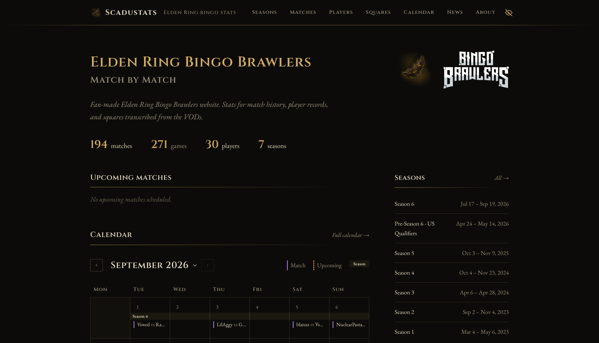

# Land of Shadow

A dark, Elden Ring–flavoured Hugo theme: ash-black and Erdtree gold by default, parchment and umber
in light mode, set in Cinzel and EB Garamond. It is the look of
[scadustats.com](https://scadustats.com/) ([source](https://github.com/adri0/scadustats-site)).



It started from the [kopi](https://github.com/bect/kopi) theme (MIT) (see
[How it differs from kopi](#how-it-differs-from-kopi)). Its styles have since been rewritten; what's
left of kopi is `assets/js/kopi/`, the structure of some layouts (`layouts/404.html`, the header,
footer and page) and `static/favicon.ico` (see `LICENSES/kopi.txt`). kopi's search, radio player, bookmarks, PWA, cookie banner, taxonomy pages
and Markdown render hooks were left out. Page navigation uses [Hotwire Turbo](https://turbo.hotwired.dev/)
8.0.20 (MIT, © 37signals), in `assets/js/third_party/` unmodified from its npm release. (Not `vendor/`: Go module
zips, which Hugo downloads modules as, leave out any directory named `vendor`.)

## Using it

Requires Hugo **Extended** >= 0.158 and Go. Import it as a Hugo module:

```toml
# hugo.toml
[module]
  [[module.imports]]
    path = "github.com/adri0/land-of-shadow"
```

```sh
hugo mod init github.com/you/your-site
hugo mod get github.com/adri0/land-of-shadow@latest
```

The theme gives you `baseof.html`, `page.html` (with a table of contents built from the `##`
headings, in a box beside the text on wide screens), `section.html`, `404.html`, a home page and the head, header, footer and breadcrumb
partials.

### Home page

The theme's `home.html` shows a hero (`logo` and `wordmark`, or the site title, then `subtitle` and
the text of `content/_index.md`), the latest news, and a card for each other section with its
`description` or summary. For your own home page, add `layouts/home.html` to your site: the hero
classes (`.hero`, `.hero-title`, `.hero-logo`, `.hero-wordmark`, `.hero-subtitle`, `.hero-body`) and
the `latest-news.html` partial are there to reuse.

### News

Put posts in `content/news/` (with a `_index.md` for the section's title) and the theme lists them,
newest first, at `/news/`. `hugo new content news/2026-10-11-my-post.md` starts a post from the
theme's archetype, which takes the title from the file name without the date. A post gets the same
table of contents as a page, from its top heading level (`##`, or `###` when it has no `##`). Front
matter:

| Field | Used for |
|---|---|
| `title`, `date` | The post's heading and date |
| `summary` | The text on the post's card in the list (default: the start of the post) |
| `author` | `{name, url}`, signed at the end of the post, linked when `url` is set. A plain string is a name without a link |

To show the latest posts on your home page, call the partial from `layouts/home.html`:

```go-html-template
{{ partial "latest-news.html" (dict "count" 3) }}
```

It shows each post's date, title and first sentence, under a heading linking to `/news/`, and
nothing when there are no posts. Every key is optional: `count` (3), `section` (`"news"`),
`title` (`"News"`) and `more` (`"All news →"`, the link's text). For a section with another name,
pass `section` and give the section `cascade: {type: news}` in its `_index.md`, so its pages use the
news layouts.

The list uses `.card-list` and `.link-card` (rows with a title, a date line and a summary), which
you can use for your own lists too.

### Calendar

The `calendar.html` partial draws a calendar from events you give it, one month at a time: a
month selector (‹ month ›) with the legend on the same line, then the month as a Monday-first grid,
or as a list at phone width. Only months with events, or that a span covers, are listed. It opens on the next month with
events from today on, else the latest one, and `?month=YYYY-MM` links to a month. Without
JavaScript every month shows. Use one per page.

```go-html-template
{{ partial "calendar.html" (dict "events" $events "spans" $spans "legend" $legend) }}
```

| Key | |
|---|---|
| `events` | Dicts with `date` (`"YYYY-MM-DD"`), `kind`, `title` and `url`. Optional: `time` (`"HH:MM"`, UTC, shown in the visitor's time zone) and `list_only` (left out of the grid, e.g. a span's start and end). Other keys are passed through to `calendar-event.html` |
| `spans` | Optional. Dicts `{title, url, start, end}`, each drawn as a bar across its days in the grid, e.g. a season |
| `legend` | Optional. Dicts `{label, kind}`: a sample of that kind of event, or with `kind: span` a bar |
| `heading` | Optional. The tag of each month's title (`"h2"`; pass `"h3"` under a section heading) |

Each event is drawn by `calendar-event.html` as `<li class="calendar-event calendar-event-<kind>">`
with its title, linked, and its time. Override that partial in your site to show more; it gets
`{event, full}`, where `full` is false in a grid cell and true in the list. Events are marked in
`--calendar-event-color` (default `--accent`), which you can set per kind in your styles, e.g.
`.calendar-event-final { --calendar-event-color: #e8913a; }`. Spans use `--calendar-span`
(default `--gold-soft`).

### Params

| Param | Used for |
|---|---|
| `description` | `<meta name="description">`, and the footer text unless you override `hooks/footer-about.html` |
| `homeTitle` | The home page's `<title>` (default: the site title) |
| `logo` | An image under `assets/`: the header mark, favicon, touch icon and `og:image` |
| `wordmark`, `wordmarkAlt` | An image of the site's name, white on transparent, shown after the logo (inverted in light mode). Without it, the header shows the site title as text |
| `subtitle` | A small line after the brand in the header |
| `repo` | A GitHub repo URL: the footer's GitHub link and the "[edit this page]" links (to its `main` branch) |
| `disclaimer` | A line at the bottom of the footer |
| `htmlAttributes` | A table of extra attributes for `<html>` |
| `colorScheme` | `"dark"` or `"light"`: always that mode, with no light/dark toggle in the header |

Menus: `main` is the header navigation, `footer` the footer links. A footer entry's `pre` goes
before its name, e.g. an inline SVG icon, sized like the GitHub one.

### Extending it

Put a file at the same path in your site to fill in these, which the theme leaves empty:

- `layouts/_partials/hooks/head-end.html`: tags at the end of `<head>` (analytics, early scripts).
- `layouts/_partials/hooks/header-actions.html`: header buttons, before the light/dark toggle if
  there is one.
- `layouts/_partials/hooks/footer-about.html`: the footer's text under the site title.
- `layouts/_partials/sidebar.html`: the 404 page's sidebar.
- `assets/css/_site.scss`: your styles, imported after the theme's. The tokens below and the
  mixins in `_tokens.scss` are available: `md` (768px and up), `gold-rule` (a gold hairline
  fading out to the right, as under section headings) and `label` (Cinzel small capitals).
- `assets/js/site.js`: export an `initSite()` function, which runs on every Turbo page load after
  the theme's modules.

### Tokens

Everything the theme draws with is a custom property in `assets/css/_tokens.scss`:

- Colour: `--bg`, `--bg-raised`, `--fg`, `--fg-muted`, `--fg-faint`, `--rule`, `--rule-strong`,
  `--tint`, `--tint-strong`, `--accent` (Erdtree gold), `--accent-tint`, `--accent-glow`, `--link`,
  `--focus`. Dark values on `:root`, light ones under `[data-theme="light"]`.
- Type: `--font-display` (Cinzel), `--font-body` (EB Garamond), `--font-mono`, the sizes
  `--fs-xs` … `--fs-2xl`, `--lh-tight`, `--lh-base`, `--tracking-display`, `--tracking-label`.
- Space: the scale `--sp-1` … `--sp-9` (4px-based) and the rhythms built on it:
  `--space-section`, `--space-block`, `--space-stack`, `--row-pad`.
- Frame: `--radius`, `--measure`, `--max-width`, `--header-height`.

The kopi-era names (`--bg-body`, `--text-main`, `--surface`, `--gold-soft`…) still work as
aliases, so older site styles keep working.

The site is dark by default: the inline script in `head.html` only switches to light when the
visitor picked it with the toggle (`localStorage.theme`), and it ignores the OS colour scheme.
Set `colorScheme` to keep one mode and hide the toggle.

## How it differs from kopi

kopi is a blog and magazine theme with a dark mode, a two-column layout and Turbo page
transitions. Land of Shadow keeps its light/dark toggle, phone menu and Turbo, and turns it from a blog
into a site of reference pages:

- **Its own look:** its own styles on one set of design tokens, sober and spacious: a palette of
  ash-black and Erdtree gold (parchment and umber in light mode), Cinzel and EB Garamond in place
  of kopi's system sans-serif, Cinzel small-capital labels and gold hairlines rather than frames
  and cards. It's dark by default, whatever the OS setting, or one mode only with `colorScheme`.
- **Pages as well as posts:** pages and news posts have a sticky table of contents built from their
  headings, "[edit this page]" links to the source on GitHub, and a full-width banner block under
  the header. Tables and headings are styled for data pages.
- **A news section** with a card list, signed posts, an archetype and a latest-news block for the
  home page. The home page has a hero with logo and wordmark.
- **A calendar** partial: month grid and list, a month selector, spans drawn as bars.
- **Extension points:** hook partials for `<head>`, the header buttons and the footer, and a site
  stylesheet and script that the theme loads last.
- **Less:** kopi's search, radio player, bookmarks, PWA, cookie banner, taxonomy pages, share
  buttons and Markdown render hooks are gone.

## Working on it with a site

Point the site at a local checkout:

```sh
HUGO_MODULE_REPLACEMENTS="github.com/adri0/land-of-shadow -> /path/to/land-of-shadow" hugo server
```

Releases are git tags (`vX.Y.Z`). Sites update with `hugo mod get github.com/adri0/land-of-shadow@vX.Y.Z`.
